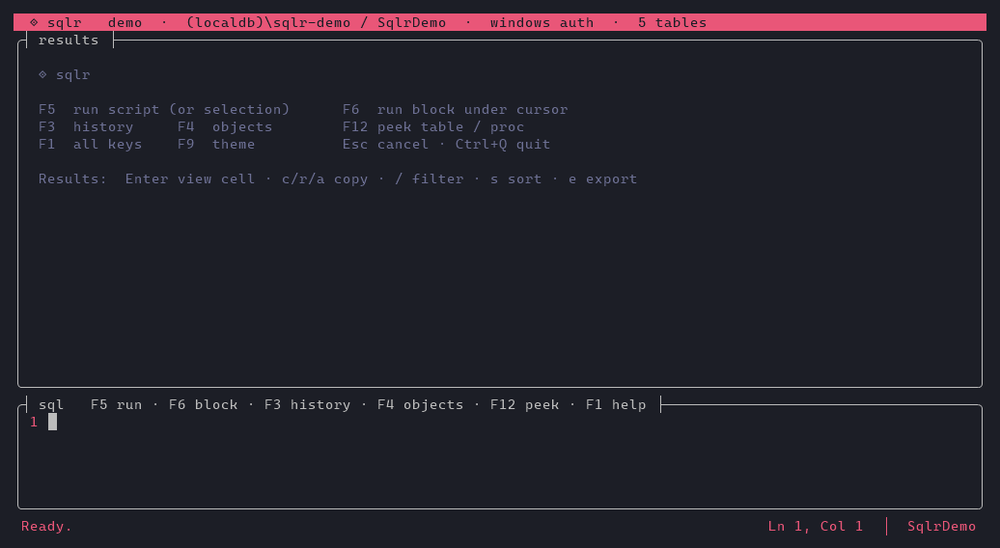
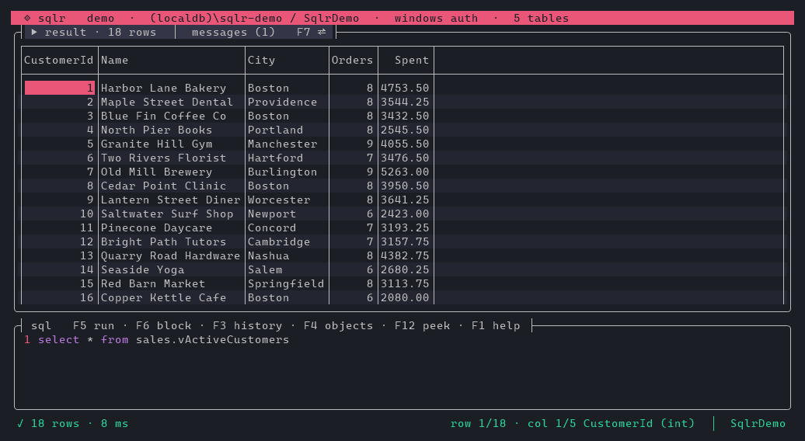
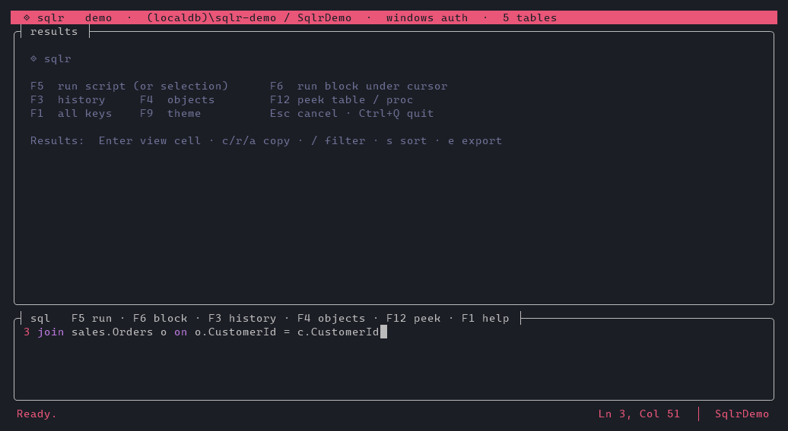
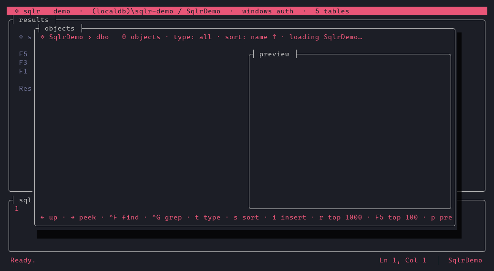
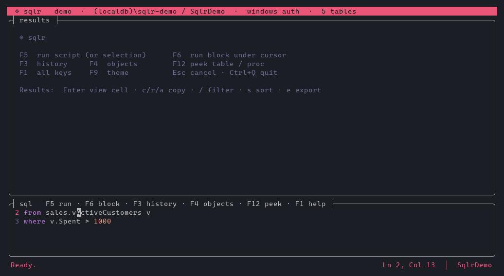
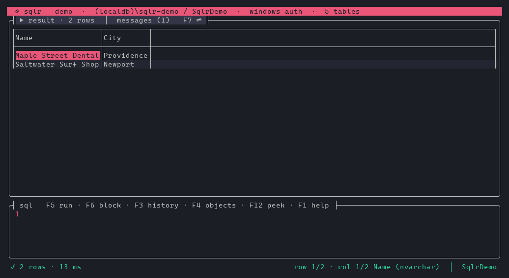
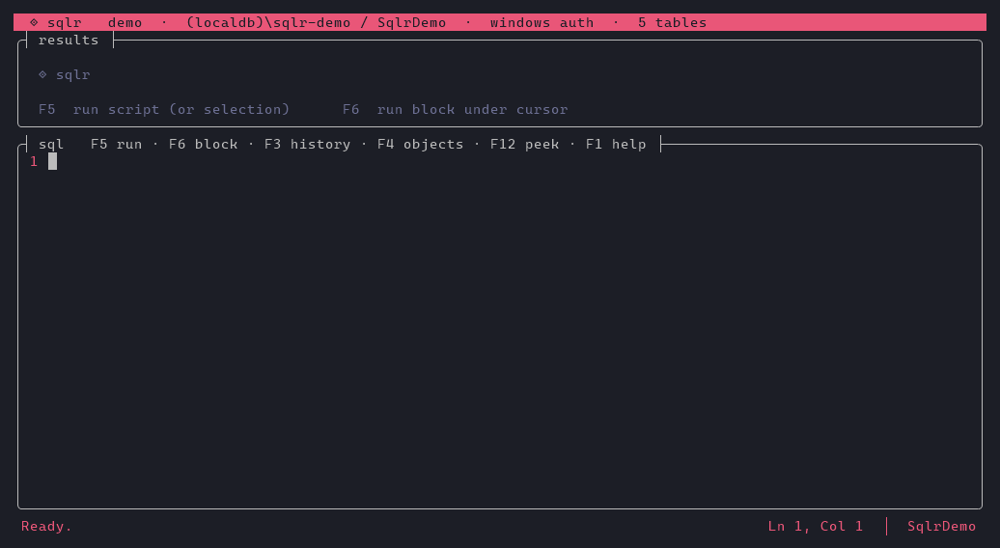
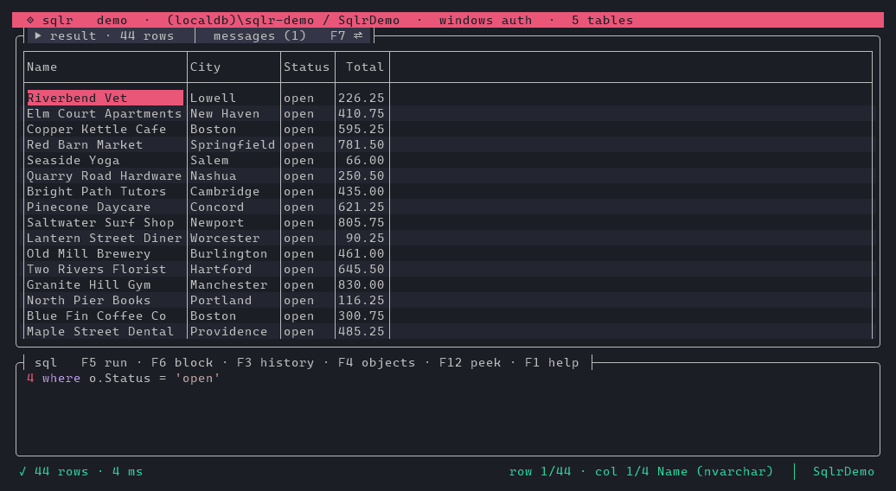

# sqlr

A SQL Server client for the terminal. It opens instantly, completes as you type, and you never have to touch the mouse.



I wanted something that starts as fast as `vim`, knows my schema, and runs a migration script without a GUI getting in the way. sqlr is one exe, no install, no splash screen. The schema loads in the background so you can start typing right away.

---

## What it does

### Write and run

Completions come from your live schema: tables after `FROM` and `JOIN`, columns of the tables in your query, aliases (`o.` gives you the columns of `o`), procs after `EXEC`, databases after `USE`, `@variables`, CTEs. `Tab` or `Enter` takes the suggestion. `Enter` still gives you a new line when the word is already finished, or when you're typing a table's alias, so `FROM Orders o⏎` stays `o`.

`F5` runs the whole script, or just the selection if you have one. `F6` runs the block under the cursor (the lines between blank lines). `GO` and `GO 5` work like in SSMS, and `Esc` cancels a query that's taking too long.

### Look at the results



Every result set gets its own tab, plus a Messages tab for PRINT, row counts and errors (`F7` flips between them). In the grid, `s` sorts by the column you're on, `/` filters rows, and `Enter` opens the full value of a cell, JSON and XML pretty printed. `Tab` in there shows the whole row. `c` / `r` / `a` copy a cell, a row or everything (tab separated, so it pastes straight into Excel), and `e` exports to CSV, TSV, JSON, Markdown or INSERT statements.

### When something breaks



Errors show the line number of your editor, not of the batch, and the cursor jumps there. The name the error is about gets marked in red (`Totl` in "Invalid column name 'Totl'"), and the mark goes away as soon as you start fixing it.

### Find your way around



`F4` opens the object explorer: databases › schemas › tables, views, procs and functions. The right side previews whatever you're on: columns, keys, indexes and row count for a table, the definition for a view or proc. `r` writes a `SELECT TOP (1000)` for the table into the editor and runs it, `F5` just shows the top 100, and `i` drops the name into your query. `h` / `l` work too if your fingers are used to vim.

### Grep everything


`Ctrl+G` in the explorer searches object names, column names and the code of every proc, view, function and trigger. Basically "where is this column used?". Run it from the database list and it searches every database in the list (`Ctrl+F` there first to narrow it down). Search by a plain name, `EDI.Orders`, or the full `CMaster.EDI.Orders`. `Enter` opens the definition on the matching line.

### Peek



`F12` on any table, view, proc or alias in your query shows its columns, types, keys and defaults, or its parameters. `Tab` switches to the definition. `/` filters the columns or searches the code.

### History



`F3` lists every query you've run, with how long it took and whether it worked. Type to filter, `Enter` puts it back in the editor, `F5` puts it back and runs it.

### Paste a whole script



Terminals paste by typing the text in one key at a time, which used to mean watching a long migration script crawl in line by line. sqlr spots a paste and drops it in all at once: a tab in the script doesn't send you off to the results, nothing gets autocompleted along the way, and one `Ctrl+Z` takes the whole thing back out.

### Themes



`F9` picks a theme and previews it live as you move through the list. There are 12: classic, horizon, tokyodark, pastel-inu, tokyo-night, catppuccin, rose-pine, kanagawa, dracula, nord, gruvbox and synthwave. Your pick is remembered.

### And the rest

- **Line numbers** next to the editor.
- **Drafts.** Whatever is in the editor is kept per connection, so you pick up where you left off.
- **Files.** `Ctrl+O` / `Ctrl+S` open and save `.sql` files, or start with `sqlr -c prod script.sql`.
- **Connections** with Windows auth, SQL logins, or a Windows domain account from a Mac or Linux box. Passwords go in the macOS Keychain, or DPAPI-encrypted on Windows.
- **Scriptable.** `sqlr -c prod -q "select …" -f csv` for pipes and scripts.
- **Doesn't fall over.** A dropped connection is reopened on the next run, and huge results are capped without skipping the statements after them.
- **One file.** Self-contained exe, no .NET needed on the machine you run it on.

---

## Install

You need the [.NET 10 SDK](https://dotnet.microsoft.com/download) to build it, and a SQL Server you can reach.

```powershell
git clone https://github.com/lmartins18/sqlr
cd sqlr
.\publish.ps1           # → dist\win-x64\sqlr.exe, one file
```

Put it somewhere permanent and add it to your PATH:

```powershell
New-Item -ItemType Directory -Force C:\tools\sqlr
Copy-Item .\dist\win-x64\sqlr.exe C:\tools\sqlr\
C:\tools\sqlr\sqlr.exe --add-to-path    # then restart your terminal
```

Then add a connection with `sqlr connections add`. Running plain `sqlr` with nothing saved starts the same thing.

---

## Usage

```
sqlr                                   pick a saved connection
sqlr -c <name> [-d <db>] [file.sql]    open the editor (optionally with a file)
sqlr -c <name> -q "<sql>" [-f fmt]     run a query, print results, exit
sqlr -c <name> -i script.sql [-f fmt]  run a script file, print results, exit
echo "select 1" | sqlr -c <name>       run SQL from stdin

sqlr connections                       list saved connections
sqlr connections add                   add one
sqlr connections edit <name>           edit one
sqlr connections remove <name>         remove one
sqlr connections test <name>           test it

sqlr --add-to-path                     add the install folder to your PATH
sqlr --help | --version
```

`-f` picks the output for `-q` and `-i`: `table` (default), `csv`, `tsv`, `json`, `md` or `sql`. Results go to stdout, messages (PRINT, row counts, errors) to stderr. The exit code is `1` if a statement failed and `2` for bad arguments.

---

## Keys

`F1` shows all of these inside the app.

### Connection picker

| Key | Does |
|---|---|
| `↑` `↓`, `Enter` | Move, connect |
| `A` / `E` / `C` | Add / edit / clone a connection |
| `D` | Delete it |
| `T` | Test it (the result shows in the status line) |
| `F9` | Theme |
| `Q` / `Esc` | Quit |

### Editor

| Key | Does |
|---|---|
| `F5` / `Ctrl+R` | Run the script, or the selection if there is one |
| `F6` / `Ctrl+E` | Run the block under the cursor |
| `Esc` | Cancel a running query, or close the completions |
| `Ctrl+Space` | Show completions |
| `Tab` or `Enter` | Take the highlighted completion (`↑` `↓` to pick another) |
| `Ctrl+/` or `Alt+/` | Comment / uncomment the line or the selected lines |
| `Ctrl+Backspace`, `Ctrl+W`, `Alt+Backspace` | Delete the word on the left |
| `Ctrl+Delete`, `Alt+D` | Delete the word on the right |
| `Ctrl+Z` / `Ctrl+Y` | Undo / redo |
| `Ctrl+S` / `Ctrl+O` | Save / open a `.sql` file |
| `Tab` | Jump to the results |

### Results

| Key | Does |
|---|---|
| Arrows, `PgUp` `PgDn`, `Home` `End` | Move around |
| `Enter` or double-click | Full value of the cell (`Tab`: the whole row, `n` / `p`: next / previous row) |
| `c` / `r` / `a` | Copy the cell / row / all rows |
| `/` | Filter rows (`Esc` clears it) |
| `s` | Sort by this column (asc, desc, off) |
| `e` | Export (`.csv` `.tsv` `.json` `.md` `.sql`, by the extension you type) |
| `F7` / `Shift+F7` | Next / previous result set or Messages |
| `Enter` on an error | Jump to its line in the editor |
| `Esc` / `Tab` | Back to the editor |
| Right-click | Copy the cell |

### Object explorer (`F4`)

| Key | Does |
|---|---|
| `←` `h` `Backspace` | Up a level (objects → schemas → databases) |
| `→` `l` `Enter` | Down a level, or open the object's `F12` view |
| `Ctrl+F` or `/` | Filter the list as you type (`Enter` keeps it, `Esc` clears it) |
| `Ctrl+G` | Grep names, columns and definitions (from the database list: every database listed). `Tab` moves into the matches, where `i` inserts the object's name |
| `t` | Show only tables, views, functions or procs |
| `s` | Sort by name, type or last modified |
| `i` | Insert the name into the editor |
| `r` | `SELECT TOP (1000)` into the editor and run it |
| `F5` | `SELECT TOP (100)` into the results, leaving the editor alone |
| `p` | Hide / show the preview |
| `Ctrl+D` / `Ctrl+U` | Scroll the preview |

### F12 view

| Key | Does |
|---|---|
| `/` or `Ctrl+F` | Filter the columns, or search the definition |
| `n` / `N` | Next / previous match |
| `Tab` | Columns ⇄ definition |
| `c` | Copy |
| `Esc` | Clear the search, then close |

### Anywhere

| Key | Does |
|---|---|
| `F1` | All the keys |
| `F2` | Clear the results |
| `F3` | History |
| `F4` | Object explorer |
| `F8` | Resize the panes |
| `F9` | Theme (`Enter` keeps it, `Esc` goes back) |
| `F10` | Switch connection |
| `F12` | Peek what's under the cursor |
| `Ctrl+Q` | Quit (the editor text is kept) |

---

## Completions, in detail

| Where the cursor is | You get |
|---|---|
| After `FROM` / `JOIN` / `UPDATE` / `INTO` | Tables, views, CTEs, schemas. Anything outside `dbo` goes in schema-qualified |
| After a table (`FROM t x ▌`) | `WHERE`, `JOIN`, `ON`, `GROUP BY`, … |
| After `SELECT` / `WHERE` / `ON` / `ORDER BY` / … | Columns of the tables in the query, aliases, functions, keywords |
| After `alias.` or `table.` | That table's columns |
| After `schema.` / `sys.` | Objects in that schema |
| Inside `INSERT INTO t (…)` | Columns of `t` |
| After `EXEC` | Procs and functions |
| After `USE` | Databases |
| Typing `@` | Variables in the script |
| In a string or comment | Nothing |

Matching is prefix first, then anywhere in the name, then fuzzy (`ordr` finds `ORDER`). Names with spaces or reserved words go in `[bracketed]`, and `db..` expands to `db.dbo.`.

---

## Config

Everything lives in `~/.sqlr` (or wherever `SQLR_HOME` points):

| File | What's in it |
|---|---|
| `connections.json` | Saved connections |
| `settings.json` | Optional settings, below |
| `history.jsonl` | Query history |
| `drafts/<connection>.sql` | The editor text for each connection |
| `theme` | Your `F9` pick |
| `error.log` | Details of anything that went wrong inside sqlr |

```json
{
  "connections": [
    { "name": "staging", "server": "db-server.internal", "database": "MyApp", "authType": "windows" },
    { "name": "local",   "server": "localhost,1433",     "database": "",      "authType": "sql", "username": "sa" },
    { "name": "mac",     "server": "db.corp.local",      "database": "MyApp", "authType": "domain", "username": "CORP\\jdoe" }
  ]
}
```

An empty `database` uses the login's default database.

### Passwords

You type them in `sqlr connections add` or the picker, and where they end up depends on the OS:

| OS | Kept in |
|---|---|
| macOS | Your login **Keychain**, one item per connection (service `sqlr`, account = the connection name). `security find-generic-password -s sqlr -a staging -w` shows one |
| Windows | `connections.json`, DPAPI-encrypted (`protectedPassword`), readable only by your Windows account |
| Linux | `connections.json` in plain text, in a file only you can read (`0600`) |

Old configs with plain-text passwords get moved over the next time sqlr starts. Renaming or deleting a connection moves or deletes its Keychain item too.

On macOS, after you update sqlr, it asks once per password whether the new build can use it (the binary is ad-hoc signed, so every build looks like a new app). Pick **Always Allow**. Over SSH the Keychain is locked: run `security unlock-keychain` first, or set `SQLR_NO_KEYCHAIN=1` to keep passwords in the `0600` file instead.

### Logging in

| `authType` | Logs in as | Use it |
|---|---|---|
| `windows` | The Windows account you're signed in with | On a domain-joined Windows machine. On macOS / Linux only with a Kerberos ticket (`kinit you@CORP.LOCAL`) |
| `sql` | A SQL Server login | When the server has SQL logins |
| `domain` | A Windows domain account, `CORP\jdoe` or `jdoe@corp.local`, with its password, over NTLM | From a Mac or Linux box, like DataGrip's "domain credentials". Nothing to install or join |

`domain` works on Windows too, handy for logging in as a different domain account. The server has to allow NTLM, which domain SQL Servers do unless someone turned it off.

### settings.json

All optional:

```json
{
  "maxRows": 100000,           // rows kept per result set (later statements still run)
  "queryTimeoutSeconds": 0,    // 0 = no timeout, cancel with Esc instead
  "maxColumnWidth": 60,        // widest a grid column gets (Enter shows the full value)
  "historySize": 2000
}
```

---

## Other platforms

```powershell
.\publish.ps1 -Runtime linux-x64
.\publish.ps1 -Runtime osx-x64
.\publish.ps1 -Runtime osx-arm64     # Apple Silicon
```

Or `dotnet publish -c Release -r <rid> --self-contained true -p:PublishSingleFile=true -o ./dist/<rid>`.

---

## Development

```bash
dotnet build
dotnet test tests/Sqlr.Tests
```

The unit and UI tests drive the real screens through Terminal.Gui's `FakeDriver` and need nothing else. The integration tests run when `SQLR_TEST_SQL` points at a SQL Server you can create databases on; they build their own `SqlrTest` / `SqlrOther` databases from `tests/Sqlr.Tests/Integration/setup.sql`:

```bash
docker run -d --name sqlr-test-mssql -e ACCEPT_EULA=Y -e 'MSSQL_SA_PASSWORD=Sqlr_Test_Pw1!' \
  -p 14333:1433 mcr.microsoft.com/mssql/server:2022-latest
SQLR_TEST_SQL='Server=localhost,14333;User Id=sa;Password=Sqlr_Test_Pw1!;TrustServerCertificate=true' \
  dotnet test tests/Sqlr.Tests
```

The clips in this README are recorded from the real app, key by key, against a small made-up database (`tests/Sqlr.Tests/Demo`). To record them again on Windows:

```powershell
sqllocaldb create sqlr-demo -s
$env:SQLR_RECORD_DEMOS = 1
dotnet test tests/Sqlr.Tests --filter "FullyQualifiedName~DemoClips"   # → docs/demo/*.gif
```

---

## Built with

- .NET 10 / C# 14
- [Terminal.Gui v2](https://github.com/gui-cs/Terminal.Gui) for the UI
- [Microsoft.Data.SqlClient](https://github.com/dotnet/sqlclient) to talk to SQL Server
- The `sys.*` catalog views for the schema
- xUnit for the tests

## License

MIT, see [LICENSE](LICENSE).
